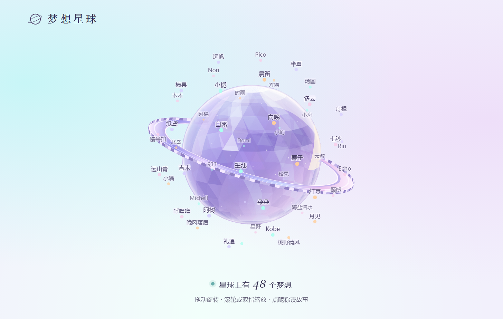

# 梦想星球 · Dream Planet

把一组故事放到一颗可以转动的水晶星球上。拖动星环，昵称会从另一侧转到眼前。点一下 **Lily**，星球停下来，她的故事《开一间有花香的书店》随之展开。



这是一个可复用的 **uni-app / Vue 3** 互动展示项目。默认页面收录了 48 条梦想故事，数据随项目提供。星球用 Canvas 2D 绘制，528 个切面的明暗随角度变化，形成玻璃般的立体感。运行示例无需配置后端，也无需安装额外的绘图库。

## 一颗星球可以装下什么？

| 场景 | 星球上的标签 | 点开后读到 |
| --- | --- | --- |
| 毕业纪念册 | 同学的昵称 | 一段想留给全班的话 |
| 活动留言墙 | 参与者的署名 | 当天的见闻或写给明年的愿望 |
| 团队成员墙 | 成员的名字 | 他擅长什么、最近在做什么 |
| 作品集 | 作品的短标题 | 创作缘起或制作手记 |

在手机上用单指拖动、双指缩放，在电脑上用鼠标拖动、滚轮缩放。密集区域会优先显示靠前的标签，文字暂时放不下时，仍可以点光点阅读。打开卡片后自转暂停，关闭后继续。

## 本地运行

1. 下载或克隆仓库，用 **HBuilderX** 打开包含 `manifest.json` 的项目根目录。
2. 在「运行」菜单选择「运行到浏览器」。首页会直接显示示例星球。
3. 想体验触屏交互，可以选择「运行到小程序模拟器 → 微信开发者工具」，或连接手机运行 App。使用自己的微信小程序时，在 `manifest.json` 的微信小程序配置中填写 AppID。

## 换成自己的内容

编辑 [故事列表](pages/dreams/stories.js)。数组里每一行依次是**星球上显示的标签、卡片标题、正文**。例如，一份毕业纪念册可以这样写：

```js
export const stories = [
  ['阿禾', '最后一班校车', '毕业那天，司机师傅像往常一样说了句“明天见”。'],
  ['北岛', '球场边的约定', '我们约好，每年夏天回学校打一场球。']
].map(([id, title, story]) => ({ id, title, story }))
```

标签同时用来查找卡片，请保持唯一。增删条目后，首页数量会自动更新。要把页面上的“梦想”也换成“毕业留言”，可以在[首页组件](pages/dreams/index.vue)修改标题、计数文案和卡片署名，在[页面配置](pages.json)修改窗口标题。

## 在其他 uni-app 页面复用

把 [dream-planet 组件目录](components/dream-planet)完整复制到项目的 `components/` 下，保留同目录的 `scene.js`。在启用 uni-app 默认组件自动注册的项目中，可以直接使用：

```vue
<template>
  <view style="width: 100%; height: 600rpx">
    <dream-planet :ids="['阿禾', '北岛', '小满']" @pick="showMember" />
  </view>
</template>

<script setup>
function showMember(id) {
  uni.showToast({ title: id, icon: 'none' })
}
</script>
```

组件会填满父容器，因此容器需要有明确的高度。`ids` 决定星球上有哪些标签，`pick` 返回被点中的标签。你可以用它打开自己的成员卡或作品页。弹窗打开时，传入 `:active="false"` 就能暂停动画。切面、星环、配色和标签排列都在[绘制代码](components/dream-planet/scene.js)中。

## 项目来源

本项目起始于 etangzeng 的 Planet Sphere，原项目声明采用 MIT 许可证。当前版本使用 Canvas 2D 绘制水晶星球，并将星球交互与故事内容拆成了可单独复用的组件和数据文件。[原项目仓库](https://gitcode.com/weixin_47770976/planet-sphere)
